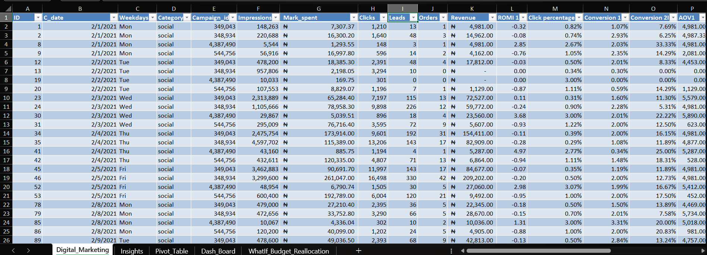
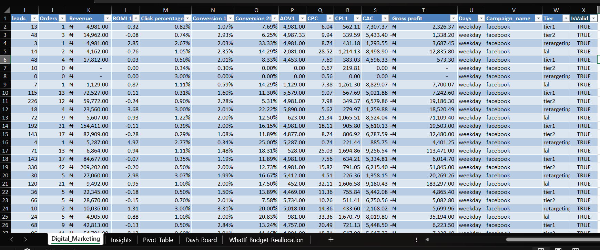
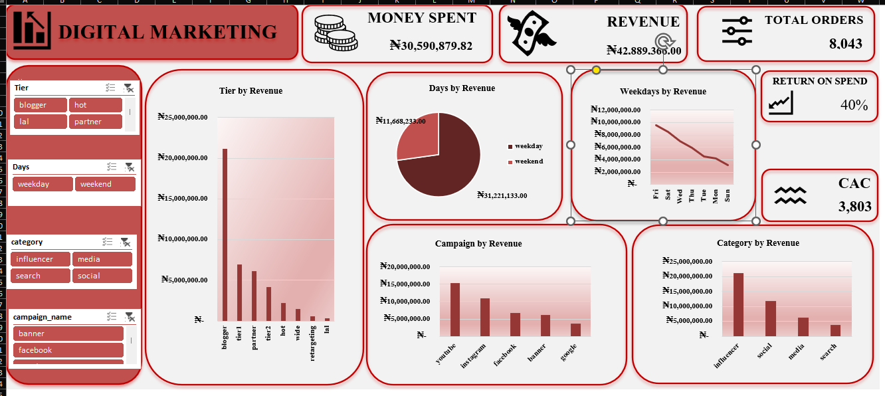

# Digital Marketing — Campaign ROI and Budget Allocation

> Which marketing campaigns, channels and locations actually pay back? An analysis of 308 daily campaign records using **SQL and Excel**, with an Excel dashboard, which found that the largest share of the budget was going to the worst-performing channel.

---

## 1. Introduction

Marketing budgets are easy to spend and hard to judge. Without a clear view of what each campaign returns, money keeps flowing to channels that feel busy but lose money.

This project analyses a month of digital marketing activity (1–28 February 2021) across five campaigns, four categories and several audience tiers. It answers six business questions about return on marketing investment (ROMI), campaign and category performance, timing and geo targeting, and ends with a clear recommendation on where to move the budget. It also catches a data error in the source file that would have **doubled** the reported return if left in.

**Key results at a glance**

| Measure | Result |
|---|---|
| Total spend / revenue | INR 30.59M / INR 42.89M |
| **Overall ROMI** | **40%** (INR 1.40 earned for every INR 1 spent) |
| Best campaign | **YouTube**: ROMI +277% |
| Worst campaign | **Facebook**: ROMI -34% |
| Best category | **Influencer**: ROMI +154% |
| Largest spend | **Social** (about 45% of budget): ROMI -14% |
| Best geo tier | **Tier 1**: +35% (tier 2: -28%) |

---

## 2. Problem Statement

Marketing budget is being allocated across campaigns, categories and geo tiers **without a clear, verified view of which ones actually generate a return.**

**The six questions this project answers:**
1. What is the overall ROMI?
2. What is the ROMI of each campaign?
3. On which dates did we spend the most, earn the most, and see high and low conversion rates? What were the average order values?
4. When are buyers more active: weekdays or weekends?
5. Which type of campaign works best: social, banner, influencer or search?
6. Which geo locations are better for targeting: tier 1 or tier 2 cities?

---

## 3. Data Sourcing

- **Dataset:** daily marketing records, with **309 rows and 23 columns**. 308 are real campaign records and one is a spreadsheet "Total" row (see Section 5).
- **Source:** [add where the dataset came from, e.g. the training provider or platform]
- **Period:** 1–28 February 2021.
- **Currency:** INR (Indian rupees), as stated in the dataset description.

| Group | Columns |
|---|---|
| Campaign | `campaign_name` (facebook, instagram, google, youtube, banner), `category` (social, media, search, influencer), `campaign_id`, `tier` (audience or geo group) |
| Date | `c_date`, weekday, weekday/weekend flag |
| Raw performance | `impressions`, `mark_spent` (marketing spend), `clicks`, `leads`, `orders`, `revenue` |
| Provided KPIs | ROMI, click percentage, conversion 1 (leads ÷ clicks), conversion 2 (orders ÷ leads), AOV, CPC, CPL, CAC, gross profit |

**Metric definitions used (from the project brief):**
- **ROMI** = (Revenue − Marketing spend) ÷ Marketing spend
- **Revenue ÷ spend ("return on spend")** = Revenue ÷ Marketing spend. This is ROMI + 1. It is shown next to ROMI so both readings are clear.

---

## 4. Tools I Used and Why

I used **SQL and Excel only**. This was a deliberate choice, not a limitation.

| Tool | What I used it for |
|---|---|
| **SQL (PostgreSQL)** | Created the table, excluded the invalid Total row, and answered all six questions with aggregations (`SUM`, `GROUP BY`, ratios with `NULLIF`). It also holds the data-quality check that shows the Total row matches the sum of all real rows |
| **Excel** | Cleaned and flagged the data, calculated the KPI columns, built the `Insights` summary, a what-if budget reallocation model, the PivotTables and the interactive **dashboard** with slicers. It reproduces the SQL numbers independently |

**Why SQL and Excel were enough:**
- **Every question is a direct aggregation.** Totals, ratios and averages by group are exactly what SQL does best, and a ratio like ROMI needs no modelling.
- **Two tools, two independent checks.** SQL and Excel are different routes to the same numbers. When they agree, the result is reliable, and a third tool would only repeat the work.
- **No Python needed.** Python is the right tool for statistical tests, large datasets or heavy cleaning. Here there was no hypothesis test to run, the data is small (308 records), and the one cleaning issue was a single row.
- **Excel covers the dashboard too.** The data is small, static and one month long, so an Excel dashboard with PivotTables and slicers answers the questions without a separate BI tool or a data refresh schedule.
- **Excel suits the audience.** Marketing and finance stakeholders already use it, and the what-if budget model is easy for them to open, change and trust.

---

## 5. Data Transformation and Cleaning

The cleaning and preparation were done in the **`Digital_Marketing`** sheet of the Excel workbook.

*The `Digital_Marketing` sheet, left side: the raw columns (`id`, `c_date`, `category`, spend, clicks, leads, orders, revenue) and the first calculated KPI columns (`ROMI 1`, `Click percentage`, `Conversion 1`, `Conversion 2I`, `AOV1`).*

*The same sheet, right side: the remaining KPI columns (`CPC`, `CPL1`, `CAC`, `Gross profit`) and the helper columns (`Days`, `campaign_name`, `Tier`, `IsValid`).*

**The key data issue: a Total row in the source file.**
- One row (id blank or 0, category "0") has **spend = 0 but revenue = 42,889,366**. It is not a campaign.
- Tracing it back to the original spreadsheet showed it is a **"Total" row** that someone added for their own reference. Its revenue equals the sum of all 308 real rows.
- **Left in, it doubles revenue.** The overall revenue ÷ spend would read **2.80x** instead of **1.40x**, and ROMI would read **180%** instead of **40%**.
- **What I did:** added an **`IsValid`** helper column with the formula `=NOT(AND(mark_spent=0, revenue>1000000))`. It returns FALSE for the Total row and TRUE for every real record. Every summary in the workbook (`SUMIFS` in `Insights` and the PivotTables) uses only the TRUE rows. In SQL the same row is excluded with `WHERE id <> 0`.

**KPI columns calculated for every record:**

| Column | Formula |
|---|---|
| `ROMI 1` | (revenue − spend) ÷ spend |
| `Click percentage` | clicks ÷ impressions |
| `Conversion 1` | leads ÷ clicks |
| `Conversion 2I` | orders ÷ leads |
| `AOV1` | revenue ÷ orders |
| `CPC` | spend ÷ clicks |
| `CPL1` | spend ÷ leads |
| `CAC` | spend ÷ orders |
| `Gross profit` | revenue − spend |

**Other checks and steps:**
- **No duplicate records** and no blank values in the 308 real rows. The only blanks were in the Total row.
- **Standardised column names** (for example `Weekdays` → `weekdays`, `Days` → `days_type`, `campaign_name.1` → `campaign_name`) in SQL.
- **Set correct data types** (dates, integers, decimals), and formatted amounts as currency and rates as percentages in Excel.
- **Safe division** with `NULLIF` in SQL and `IFERROR` in Excel, so records with zero orders or zero spend can't cause errors.
- **Cross-checked** the SQL totals against the Excel summaries to confirm they match.
- **Note on zero-revenue records:** a few records with spend but no revenue show a ROMI of 0.00 in the `ROMI 1` column, where the formula gives −1.00 (a 100% loss). The overall results are not affected, because they are calculated from total spend and total revenue.

---

## 6. Analytics and Measures

### Q1. Overall return
| Measure | Result |
|---|---|
| Total spend | INR 30.59M |
| Total revenue | INR 42.89M |
| Gross profit | INR 12.30M |
| Revenue ÷ spend | **1.40x** |
| **ROMI** (revenue − spend) ÷ spend | **40%** |

### Q2. By campaign
| Campaign | Spend | Revenue | Revenue ÷ spend | ROMI |
|---|---|---|---|---|
| YouTube | 4.06M | 15.31M | 3.77x | **+277%** |
| Instagram | 7.88M | 11.02M | 1.40x | +40% |
| Banner | 5.03M | 6.15M | 1.22x | +22% |
| Google | 3.46M | 3.71M | 1.07x | +7% |
| Facebook | 10.17M | 6.70M | 0.66x | **−34%** |

### Q3. Performance by date
- The highest-spend day and the highest-revenue day were the same: **20 February 2021** (spend 3.50M, revenue 5.26M).
- Average order value stayed steady across the top five spend days (about 4,692–4,760).
- The best conversion day was **10 February** (2.83% leads per click). The worst was **2 February** (1.29%), less than half as good.

### Q4. Weekday vs weekend
Average revenue per campaign-day record was **141,914 on weekdays** and **132,594 on weekends**, about 7% higher on weekdays. This is a real but modest gap, and not a reason to change the schedule on its own.

### Q5. By category
| Category | Spend | Revenue | Revenue ÷ spend | ROMI |
|---|---|---|---|---|
| Influencer | 8.31M | 21.12M | 2.54x | **+154%** |
| Media (banner) | 5.03M | 6.15M | 1.22x | +22% |
| Search | 3.46M | 3.71M | 1.07x | +7% |
| Social | 13.80M | 11.91M | 0.86x | **−14%** |

**Social is the largest spend category (about 45% of the budget) and it loses money.**

### Q6. Geo targeting: tier 1 vs tier 2
| Tier | Spend | Revenue | Revenue ÷ spend | ROMI |
|---|---|---|---|---|
| Tier 1 | 5.13M | 6.94M | 1.35x | **+35%** |
| Tier 2 | 5.76M | 4.13M | 0.72x | **−28%** |

The gap also holds **in every one of the four weeks** of the period (tier 1 between 1.17x and 1.43x, tier 2 between 0.69x and 0.79x revenue ÷ spend), not just in the total.

### SQL techniques used
`SUM` and `GROUP BY` for rollups, `NULLIF` for safe ratios, `WHERE` filters for tiers, `ORDER BY ... LIMIT` for top dates, and a reconciliation query that proves the Total row equals the sum of the real rows.

---

## 7. Dashboard and Visuals

The interactive dashboard is the `Dash_Board` sheet of the Excel workbook. It is built from PivotTables, with slicers that filter every chart at once.

**Headline cards (top row)**
- **Money Spent:** 30,590,879.82. The total marketing spend.
- **Revenue:** 42,889,366.00. The total revenue earned.
- **Total Orders:** 8,043.
- **ROMI:** 40%. The profit earned on each unit of spend, calculated as (revenue − spend) ÷ spend. Revenue ÷ spend is 1.40x.
- **CAC:** 3,803. Customer acquisition cost, which is spend ÷ orders.

**Charts**
- **Tier by Revenue:** `blogger` is far ahead at about 21.1M, followed by tier 1 (6.9M), partner (6.2M) and tier 2 (4.1M). The lowest are retargeting and lal.
- **Days by Revenue:** weekdays bring in 31.2M and weekends 11.7M (about 27% of revenue).
- **Weekdays by Revenue:** days ranked from highest to lowest revenue. Friday (9.6M) and Saturday (8.5M) lead, and Sunday (3.1M) is lowest.
- **Campaign by Revenue:** YouTube (15.3M) leads, then Instagram (11.0M), Facebook (6.7M), banner (6.2M) and Google (3.7M).
- **Category by Revenue:** influencer (21.1M) is about half of all revenue, then social (11.9M), media (6.2M) and search (3.7M).

**Slicers (left side):** Tier, Days (weekday or weekend), Category and Campaign name. Selecting one updates the cards and every chart, so any combination can be examined.

*Amounts are in INR, the currency of the dataset. The currency symbol on the dashboard is a display format only.*

**Supporting sheets in the workbook**
- **`Insights`:** spend, revenue, orders, return and CAC by tier, with an overall total that excludes the Total row.
- **`Pivot_Table`:** the PivotTables that feed the dashboard charts.
- **`WhatIf_Budget_Reallocation`:** a model where you choose a source tier, a target tier and the share of budget to move, and it shows the effect on total revenue.

**What the dashboard shows:** revenue is concentrated in the **influencer / blogger** channel, which also gives the best return. The dashboard shows revenue only, so the spend side of each channel, which the analysis in Section 6 uses to compare returns, sits in the `Insights` sheet and the SQL results.

---

## 8. Recommendation

1. **Move budget from Facebook and the Social category toward YouTube and Influencer.** Facebook and Social lose money, while YouTube and Influencer return 2–6x more per unit spent.
2. **Prioritise tier 1 over tier 2 geo targeting.** Tier 1 returns +35% and tier 2 loses 28%, and the gap is consistent.
3. **Test before a full switch.** Shift about 20% of the Facebook budget to YouTube first, and compare results before committing more.
4. **Add a standing data-quality check** (flag any row with spend = 0 but a very large revenue) so a future data refresh can't bring the Total-row error back. Also ask the owner of the source spreadsheet to keep summary rows out of exports.
5. **Re-run the analysis monthly** to confirm the advantage of YouTube and Influencer holds beyond this one month.

---

## 9. Conclusions

- **Overall marketing is profitable (ROMI 40%), but the return is very uneven.** YouTube returns +277% while Facebook loses 34%.
- **The biggest share of the budget goes to the weakest channel.** Social takes about 45% of spend and returns less than it costs.
- **Where you target matters.** Tier 1 audiences return +35% and tier 2 loses 28%.
- **Data quality changed the result.** One invalid Total row would have doubled the reported revenue and made the whole programme look twice as good as it is. Checking the data before calculating prevented a false conclusion.
- **Limitation:** this covers one month (28 days) of data. The findings are a strong reason to run a controlled budget test, not a guarantee that the pattern holds all year.

---

*Prepared by Nwogbe Onyinyechi Victoria · Data Analyst*
